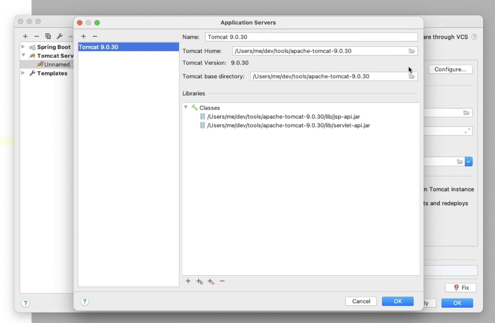
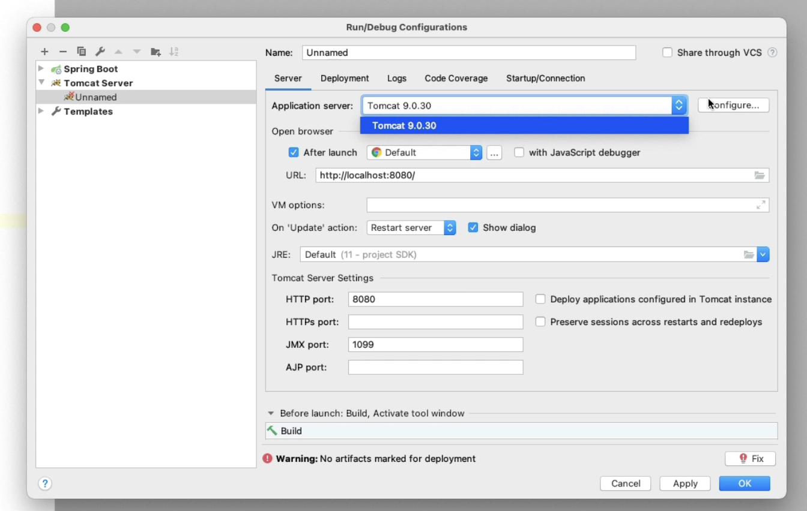

# Spring JPA Demo

This is a simple JPA (Java Persistence API) demo project.

> Project original version: (See Pluralsight course  
> [Spring Framework: Spring Data JPA 5 with Hibernate](https://app.pluralsight.com/library/courses/spring-jpa-hibernate) By Bryan Hansen)

## Getting Started

1. Clone the repository.
2. Build the project with Maven. 
3. Run the project with Tomcat 9.x (Downlaod manaully).
   

   

## Database Creation

Start mysql:9.7 via docker-compose:
```shell
cd <repo_root_folder_path>
docker-compose up -d
```

Stop mysql:
```shell
docker-compose down
```